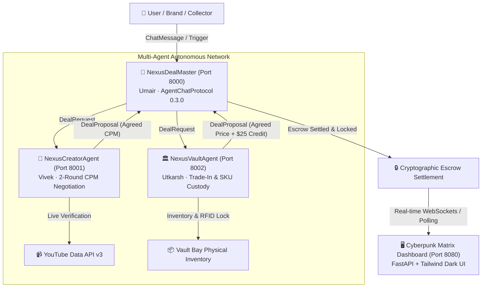

# 🌐 NEXUSDEAL: Multi-Agent Autonomous Negotiation & Cryptographic Escrow Matrix

> **Empowering decentralized commerce with autonomous negotiation agents, verifiable real-world deliverables, and cryptographic escrow settlement.**

[](https://fetch.ai/)
[](https://asi1.ai/)
[](https://fastapi.tiangolo.com/)
[](https://tailwindcss.com/)

---

## 📌 Executive Summary
**NEXUSDEAL** solves the friction, delay, and trust gap in high-value sponsorship deals and physical asset custody transactions. By deploying autonomous **Fetch.ai uAgents** communicating over **AgentChatProtocol (v0.3.0)**, NEXUSDEAL enables automated multi-round price discovery, live deliverable verification (YouTube Data API v3), physical vault appraisal with trade-in credits, and instant cryptographic escrow locking.

---

## 🏗️ System Architecture



---

## 🤖 Autonomous Agent Network

| Agent Name | Assigned | Listening Port | Seed / Address | Responsibilities |
| :--- | :--- | :---: | :--- | :--- |
| **`NexusDealMaster`** | **Umair** | `8000` | `agent1qwz2fqqgthdu2vnsfld69gq48evmv0ggqzrjpr48djf3j9k2vhedzaxu3kh` | • Registers `AgentChatProtocol:0.3.0`<br>• Parses intent & routes `DealRequest`<br>• Aggregates proposals & locks cryptographic escrow |
| **`NexusCreatorAgent`** | **Vivek** | `8001` | `agent1q2ae2qru6t8aay0f0wepwqgxsnlcr2ynnhfx4w9udnmgxm5gkdv7qvk0ezx` | • Simulates 2-round CPM price curve ($200 floor)<br>• Checks YouTube Data API v3 for live public deliverables<br>• Issues `VERIFIED_YOUTUBE_LIVE` cryptographic proof |
| **`NexusVaultAgent`** | **Utkarsh** | `8002` | `agent1qgy29fmge7gqrk04anxr62s2qs54gdv9hfh7y6y585cvvgzsvtvx2fc3et8` | • Maintains diecast vault inventory (`GTR_CHASE`, `SUPRA_MK4`)<br>• Evaluates trade-in models with automatic **$25.00 credit**<br>• Issues `VAULT_ASSET_LOCKED` SKU & RFID custody tokens |

---

## 📜 Cryptographic Protocols (`protocols.py`)
All agents enforce cryptographic digest parity through shared Pydantic models:

1. **`DealRequest`**:
   - `deal_id: str`: Unique transaction UUID.
   - `domain_type: str`: `"combo"`, `"creator"`, or `"collectibles"`.
   - `user_query: str`: Raw prompt or item requirements.
   - `item_or_creator: str`: Target SKU or channel handle.
   - `initial_offer: float` & `max_budget: float`.
   - `trade_in_item: Optional[str]`: Physical item offered for credit appraisal.
   - `target_video_id: Optional[str]`: YouTube video ID for deliverable audit.

2. **`NegotiationRound`**:
   - `round_num: int`: Round iteration (1 or 2).
   - `actor: str`: Proposing agent identity.
   - `proposed_price: float`: Counter or settled amount.
   - `status: str`: `"COUNTER"`, `"ACCEPTED"`, or `"REJECTED"`.
   - `reasoning: str`: AI negotiation rationale.

3. **`DealProposal`**:
   - `agreed_price: float`: Settled deal rate.
   - `escrow_locked: bool`: Cryptographic lock flag.
   - `verification_status: str`: Verification tag.
   - `verification_proof: str`: Cryptographic proof token (YouTube status / RFID SKU).
   - `rounds_log: List[NegotiationRound]`: Immutable round audit trail.

---

## ⚡ Quickstart & Setup Guide

### 1. Prerequisites
- **Python**: Version `3.10` to `3.12`
- **Git**

### 2. Installation
```bash
# Clone the repository
git clone https://github.com/Howardstark0701/nexusdeal.git
cd nexusdeal

# Create and activate virtual environment
python -m venv .venv

# On Windows:
.venv\Scripts\activate
# On Linux/macOS:
source .venv/bin/activate

# Upgrade pip & install dependencies
pip install --upgrade pip
pip install -r requirements.txt
```

### 3. Environment Setup (`.env`)
Create or verify `.env` file:
```dotenv
ASI1_API_KEY=""
AGENTVERSE_API_KEY="<YOUR_FETCHAI_AGENTVERSE_KEY>"
YOUTUBE_API_KEY=""

MASTER_AGENT_SEED="nexusdeal_master_orchestrator_gcet_2026_seed"
CREATOR_AGENT_SEED="nexusdeal_creator_sponsorship_gcet_2026_seed"
VAULT_AGENT_SEED="nexusdeal_collectibles_vault_gcet_2026_seed"

MASTER_AGENT_ADDRESS="agent1qwz2fqqgthdu2vnsfld69gq48evmv0ggqzrjpr48djf3j9k2vhedzaxu3kh"
CREATOR_AGENT_ADDRESS="agent1q2ae2qru6t8aay0f0wepwqgxsnlcr2ynnhfx4w9udnmgxm5gkdv7qvk0ezx"
VAULT_AGENT_ADDRESS="agent1qgy29fmge7gqrk04anxr62s2qs54gdv9hfh7y6y585cvvgzsvtvx2fc3et8"
```

---

## 🚀 Running the Project

### Option A: Complete Localhost Demo (Single Machine)
Open 4 terminal tabs or run simultaneously:

```bash
# Terminal 1: Dashboard UI Server (Port 8080)
python dashboard.py

# Terminal 2: Master Orchestrator (Port 8000)
python master_agent.py

# Terminal 3: Creator Sponsorship Agent (Port 8001)
python creator_agent.py

# Terminal 4: Collectibles Vault Agent (Port 8002)
python collectibles_agent.py
```

### Option B: 3-Laptop Decentralized Hackathon Demo
Because each agent is registered with `mailbox=True` on the **Fetch.ai Almanac**, port forwarding is not required on college/public Wi-Fi:
- **Laptop 1 (Umair)**: Runs `python master_agent.py` & `python dashboard.py`
- **Laptop 2 (Vivek)**: Runs `python creator_agent.py`
- **Laptop 3 (Utkarsh)**: Runs `python collectibles_agent.py`

---

## 🖥️ Interactive Dashboard Features (`http://localhost:8080`)
1. **Real-Time Agent Status Grid**: Live status cards with deterministic Almanac addresses and mailbox heartbeat.
2. **Deal Configurator Drawer**: Test custom negotiations with interactive sliders for budget, trade-in assets, and YouTube video IDs.
3. **One-Click Quick Triggers**: Trigger full combo drops or individual creator/vault deals instantly.
4. **Live Terminal Stream**: Streaming log of agent communication (`[INCOMING]`, `[NEGOTIATING]`, `[VERIFIED]`, `[ESCROW]`).
5. **Cryptographic Proof Inspector**: View full JSON payload with verification hashes and audit logs.

---

## 🛠️ REST API Endpoints

| Method | Endpoint | Description |
| :--- | :--- | :--- |
| `GET` | `/` | Serves the single-page Cyberpunk Matrix UI Dashboard |
| `GET` | `/api/agents` | Returns status and Almanac addresses for all 3 agents |
| `GET` | `/api/deals` | Returns all active and settled cryptographic escrow deals |
| `GET` | `/api/stats` | Aggregated volume locked, settled deals, and round counts |
| `GET` | `/api/logs` | Real-time agent event stream |
| `POST` | `/api/trigger` | Triggers a custom or combo multi-agent negotiation |

---

## 👥 Hackathon Team (GCET 2026)
- **Umair**: Master Orchestrator, AgentChatProtocol (v0.3.0), Escrow Settlement
- **Vivek**: Sub-Agent A, CPM Negotiation, YouTube Data API v3 Verification
- **Utkarsh**: Sub-Agent B, Vault Inventory Appraisal, Trade-In Logic & Custody Lock
